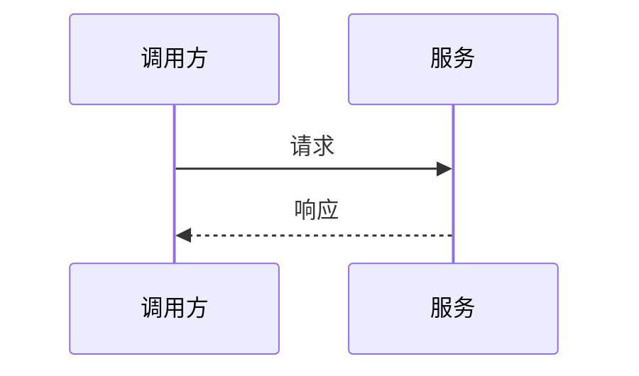

# 详细设计：【填写：任务标题】

<!-- 写给评审的人：先给结论，再给细节。M 级可整节省略第 2、9 节（保留标题并写“省略：原因”）。
代码引用统一写成 文件:行#符号，例如 src/main/java/a/B.java:42#create。 -->

## 0 评审导读

- 一句话方案：【填写：做什么、怎么做】
- 请重点看：【填写：最容易出错的 2-3 处，例如事务边界、兼容、口径】
- 影响面：【填写：改动的模块数、是否涉及库表/对外接口】

## 1 背景与目标、非目标

- 目标：【填写：对应 prd.md 的目标】
- 非目标：【填写：本次不做】

## 2 术语与约定

| 术语 | 含义 | 备注 |
| --- | --- | --- |
| 【填写：术语】 | 【填写：含义】 | 【填写：备注】 |

## 3 整体方案

- 方案摘要：【填写：三五句话说清结论】

| 方案 | 优点 | 缺点 | 结论 |
| --- | --- | --- | --- |
| A（采用） | 【填写：优点】 | 【填写：缺点】 | 采用 |
| B | 【填写：优点】 | 【填写：缺点】 | 放弃，原因：【填写：原因】 |



## 4 模块拆分

| 模块 | 职责 | 对应R | 依赖 |
| --- | --- | --- | --- |
| 【填写：模块名】 | 【填写：一句话职责】 | R1 | 【填写：依赖模块或无】 |

## 5 数据库变更

<!-- 本次需求涉及的全部库表变更集中写在这里：表、字段、索引、数据脚本、初始化数据。没有变更写“无变更：原因”。 -->

| 对象 | 变更类型 | 变更内容 | 兼容与回滚 | 对应R |
| --- | --- | --- | --- | --- |
| 【填写：表名】 | 【填写：新增表/加字段/改字段/加索引/数据脚本】 | 【填写：字段名、类型、长度、默认值、可否为空、注释；索引名与列；脚本做什么】 | 【填写：存量数据怎么处理；回滚脚本】 | R1 |

## 6 详细设计

### 6.1 【填写：模块名】

接口：

| 接口 | 方法/路径 | 入参 | 出参 | 错误码 | 对应R |
| --- | --- | --- | --- | --- | --- |
| 【填写：接口名】 | 【填写：POST /x】 | 【填写：入参】 | 【填写：出参】 | 【填写：错误码】 | R1 |

关键逻辑（伪代码，树形缩进；只写关键逻辑，不要逐步复述完整流程；事务边界、幂等、状态流转用行尾注释标出）：

```
【填写：入口方法()】  // 谁调用、何时触发
├── 【填写：新增或改动的方法()】  // 新增的标注“新增”
└── IF 【填写：条件】:
    ├── 【填写：动作】
    └── 【填写：动作】
ELSE: 【填写：动作】
```

字段与口径（只写本次新增或修改的字段；没有写“无”）：

| 字段 | 来源 | 口径/计算 | 空值语义 |
| --- | --- | --- | --- |
| 【填写：字段】 | 【填写：来源】 | 【填写：口径】 | 【填写：为空时怎么处理】 |

## 7 异常与边界

| 场景 | 触发条件 | 预期行为 | 对应测试 |
| --- | --- | --- | --- |
| 空值或超长输入 | 【填写：条件】 | 【填写：行为】 | 【填写：类#用例】 |
| 重复提交 | 【填写：条件】 | 【填写：行为】 | 【填写：类#用例】 |
| 下游超时 | 【填写：条件】 | 【填写：行为】 | 【填写：类#用例】 |

## 8 影响分析

<!-- 引用数一栏写“命令 → 命中数”。命中 5 处及以上的符号，在处置里写“高风险”并说明兼容与回归做法。 -->

| 符号 | 引用数 | 处置 |
| --- | --- | --- |
| 【填写：类#方法】 | `git grep -n "方法名"` → 0 | 【填写：不受影响/需同步修改/高风险：做法】 |

## 9 非功能

| 维度 | 要求（写数值） | 设计应对 |
| --- | --- | --- |
| 性能 | 【填写：响应时间、并发】 | 【填写：应对】 |
| 安全与可观测 | 【填写：鉴权、脱敏、日志、监控】 | 【填写：应对】 |

## 10 依赖、风险、兼容与回滚

| 类型 | 内容 | 应对 |
| --- | --- | --- |
| 外部依赖 | 【填写：依赖方/联调事项，没有写“无”】 | 【填写：应对】 |
| 兼容与迁移 | 【填写：旧数据、旧接口、客户端】 | 【填写：应对】 |
| 回滚 | 【填写：回滚办法】 | 【填写：应对】 |

## 11 覆盖矩阵与上线检查

| 需求 | 模块 | 测试 |
| --- | --- | --- |
| R1 | 【填写：模块】 | 【填写：类#用例】 |

上线检查：

- [ ] 数据库脚本已评审且可回滚
- [ ] 配置项与开关已准备
- [ ] 监控告警已配置
- [ ] 灰度与回滚方案已确认

## 12 开放问题

无
