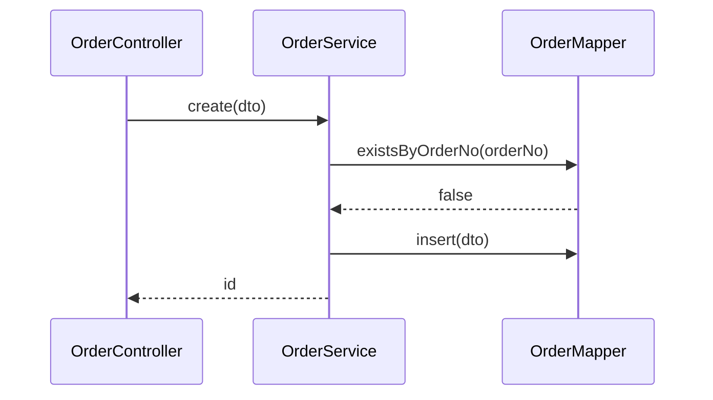

# 详细设计：订单防重复提交

<!-- 示例文档（虚构需求，代码锚点指向虚构代码），仅示范写法与颗粒度；起草时只参考版式，不要照抄内容。 -->

## 0 评审导读

- 一句话方案：在 OrderService.create 插入前按订单号查重，重复则抛业务异常，由 Controller 转成 409。
- 请重点看：并发下两个请求同时通过预检查的竞态（第 6 节，本次接受该风险，索引另立项）。
- 影响面：2 个类，无库表变更，对外接口多一个 409 响应。

## 1 背景与目标、非目标

- 目标：R1 同一订单号只创建一次；R2 重复提交返回 409 ORDER_DUP；R3 空入参行为不变。
- 非目标：不加唯一索引，不做跨订单号去重。

## 2 术语与约定

| 术语 | 含义 | 备注 |
| --- | --- | --- |
| 订单号 | OrderDTO.orderNo，业务唯一键 | 与 prd.md 一致 |
| ORDER_DUP | 重复提交错误码 | 沿用现有 4xx 错误码前缀 |

## 3 整体方案

- 方案摘要：服务层预检查 + 重复时抛 DuplicateOrderException，Controller 统一映射为 409。



## 4 数据库变更

无变更：本次不加唯一索引（另立项，D1），复用 orders.order_no 现有列和索引。

## 5 详细设计

### 5.1 OrderService

接口：

| 接口 | 方法/路径 | 入参 | 出参 | 错误码 | 对应R |
| --- | --- | --- | --- | --- | --- |
| 创建订单 | OrderService.create(OrderDTO)，现状见 src/main/java/com/acme/OrderService.java:7#create | OrderDTO | Long 订单 id | 重复抛 DuplicateOrderException | R1, R3 |

关键逻辑（伪代码）：

```
OrderController.post(dto)  // 调用 create，捕获重复异常
└── OrderService.create(dto)  // 不加事务注解，沿用调用方事务
    ├── IF dto == null: 抛 IllegalArgumentException  // 保持现状，R3
    ├── IF mapper.existsByOrderNo(dto.orderNo): 抛 DuplicateOrderException  // 新增，R1
    └── mapper.insert(dto)  // 现状见 OrderService.java:9#insert
```

字段与口径（只写本次新增或修改的字段）：

| 字段 | 来源 | 口径/计算 | 空值语义 |
| --- | --- | --- | --- |
| orderNo | OrderDTO | 精确匹配，区分大小写（查重条件，本次新增使用） | 为空时先于查重被入参校验拒绝 |

### 5.2 OrderController

- post 捕获 DuplicateOrderException，返回 409，body 为 {code: ORDER_DUP}，现状见 src/main/java/com/acme/OrderController.java:6#post（R2）。

## 6 异常与边界

| 场景 | 触发条件 | 预期行为 | 对应测试 |
| --- | --- | --- | --- |
| 空入参 | dto 为 null | 抛 IllegalArgumentException，接口 400 | OrderServiceTest#create_null_throws |
| 重复提交 | orderNo 已存在 | 抛 DuplicateOrderException，接口 409 | OrderServiceTest#create_duplicate_throws |
| 并发提交 | 两请求同时通过查重 | 可能各插入一条，本次接受，索引另立项 | 无（已在第 0 节说明） |

## 7 影响分析

| 符号 | 引用数 | 处置 |
| --- | --- | --- |
| OrderService#create | `git grep -n "OrderService.create"` → 1 | 唯一调用方 OrderController#post，同步修改 |
| OrderController#post | `git grep -n "OrderController.post"` → 0 | 无其他调用方 |

## 8 非功能

| 维度 | 要求（写数值） | 设计应对 |
| --- | --- | --- |
| 性能 | 创建接口 P99 增加不超过 10ms | 查重走 order_no 现有索引 |
| 安全与可观测 | 重复提交记录 warn 日志，含订单号 | 日志脱敏手机号 |

## 9 依赖、风险、兼容与回滚

| 类型 | 内容 | 应对 |
| --- | --- | --- |
| 外部依赖 | 无 | 无 |
| 兼容与迁移 | 旧客户端忽略 409 之外的新状态无影响 | 客户端已按 4xx 统一提示 |
| 回滚 | 回退两个类即可，无数据变更 | 无需脚本 |

## 10 覆盖矩阵与上线检查

| 需求 | 模块 | 测试 |
| --- | --- | --- |
| R1 | OrderService | OrderServiceTest#create_duplicate_throws |
| R2 | OrderController | OrderControllerTest#post_duplicate_returns409 |
| R3 | OrderService | OrderServiceTest#create_null_throws |

上线检查：

- [x] 无数据库变更
- [x] 无新增配置项
- [ ] 监控告警：新增 ORDER_DUP 计数告警
- [x] 回滚方案已确认

## 11 开放问题

无
